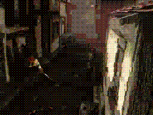
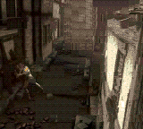

<div align="center">

# SMS/GG Media Player

<strong>在原装 Sega Master System 和 Game Gear 上各以自己的模式全屏播放视频，<br>
影片播放的同时，图块在 VRAM 中分页调入。</strong>

[English](README.md) | [日本語](README.ja.md) | 简体中文 | [繁體中文（香港）](README.zh-HK.md)

[](https://github.com/gufranco/smsgg-media-player/actions/workflows/ci.yml)
[](https://github.com/gufranco/smsgg-media-player/releases/latest)
[](https://github.com/gufranco/smsgg-media-player/actions/workflows/ci.yml)
[](LICENSE)

</div>

<p align="center">
  <a href="#快速开始"><strong>快速开始</strong></a> |
  <a href="#工作原理"><strong>工作原理</strong></a> |
  <a href="#画质"><strong>画质</strong></a> |
  <a href="#验证"><strong>验证</strong></a> |
  <a href="#播放器家族"><strong>播放器家族</strong></a>
</p>

<div align="center">



<sub>Sintel 预告片的六秒片段，来自构建好的 Master System 卡带，以主机原生的 256x192 显示。Neo Geo 播放器的 README 也以同一部影片开篇。Sintel 由 Blender Foundation 制作，采用 CC BY 3.0 许可。</sub>



<sub>同样的六秒，来自 Game Gear 卡带，<code>--target gg</code>，以屏幕原生的 160x144 按相同倍率显示，调色板取自 4096 种颜色。两段演示都由 <code>tools/scripts/make_demos.py</code> 生成：同一时段、相同设置烘焙，影片的每一帧对应 GIF 的一帧，两者都是 12 fps、71 帧，因此第 <i>n</i> 帧在两边显示同一时刻。由于播放器每次播放的前三秒都会显示进度条，每段画面都由回放预言根据各自卡带的数据流绘制；进度条消失后，无界面运行的 mednafen 捕获与各自的数据流逐像素一致。</sub>

</div>

```bash
uv --project tools run python -m smsggmedia.cartridge ~/Movies/my-film.mkv --duration 5
# build/smsggmedia.sms
uv --project tools run python -m smsggmedia.cartridge ~/Movies/my-film.mkv --duration 5 --target gg
# build/smsggmedia.gg
```

---

## 简介

一个把任意视频文件转换成 Master System 或 Game Gear 卡带的烘焙器，以及一个在原装主机上全屏显示它的 Z80 播放器。每台主机都有自己的卡带，按它自己的屏幕、颜色和声音构建。烘焙器在宿主机上运行；播放器和每一次 ROM 构建都在一个固定版本的 Docker 镜像中运行。

### 问题

Master System 和 Game Gear 共用同一个 VDP，除了图块显示之外没有任何视频硬件。它从 16 KB 的 VRAM 中绘制 8x8 的图案，VRAM 只能容纳 512 个，而一部影片需要数千个。Z80 运行在 3.58 MHz，在画面绘制期间，VDP 接收字节的速度不能快于每 29 个 T 状态一个。主机上没有时间解码任何东西，连搬运数据的时间都很紧。

### 解决方案

主机上不做任何解码。烘焙器把影片变成一串图案上传和名称表写入，并排好顺序，使每场的份额都落在 VDP 允许的时间之内。播放器每场复制一个数据块，并在垂直消隐期整体切换画面，因此永远不会看到画了一半的帧。

### 现状

完整流程已经跑通：预处理、编码器、bank 打包、Z80 播放器和操控。

| 组成部分 | 状态 |
|---|---|
| 编码器与工作集策略 | 可用，配有一个回放 oracle，与它的结果一致到小数点后五位 |
| 画面 | 256x192，整个光栅。其他比例的源会被裁剪以填满画面 |
| Z80 回放循环 | 可用。图案和名称表的连续写入以每字节 30 个周期进行，Sega 文档规定的下限为 29；调色板和名称表切换在垂直消隐期内、V 计数器保护下以 16 个周期进行。由一个构建门禁以及在 Z80 上运行构建出的回放来保证 |
| 声音 | PSG 音调合成，每场在画面之前写入。`--silent` 可以去掉。已在 Master System 和 Game Gear 上播放过 |
| 字幕 | 用 `--subtitles` 指定的 SubRip `.srt`，或与源文件同名并放在旁边的那个，会以家族共用的 8x8 字体烧录在画面底部，白字黑边，最多两行、每行 32 列 |
| 操控 | 循环播放。使用 `--menu` 时（默认关闭，因为它占用影片 32 种颜色中的 4 种），与 Neo Geo 播放器同样样式的菜单，即带有进度条和滑块、播放或暂停符号、声音关闭时的 MUTE 以及已播放时间和总时长的深色面板，会在开始时以及按下上、下、左、右或按钮 1 之后显示约三秒，然后让开画面；暂停时一直显示。按钮 1 重新开始。按钮 2 停在黑屏上，之后按按钮 1、按钮 2 或暂停键从头播放。暂停键，在 Game Gear 上为 Start 键，用于暂停和继续。使用 `--menu` 时，下键随时显示和隐藏诊断信息，暂停时按钮 1 也可以：当前帧与总帧数、卡带存储体，以及因错过垂直消隐而推迟的场数。上键关闭和打开声音，声音会在一秒内恢复。左右键跳到烘焙器每 10 秒放置的跳转点，可用 `--seek-every` 修改；跳转时在载入该点画面期间会黑屏约四分之一秒。损坏的数据流会停在红屏上 |
| 场频 | 按 NTSC 节奏设定，每秒 59.92 场，Game Gear 也以此运行。播放器每场绘制一个数据块，因此 50 Hz 的 PAL 主机会以预期速度的约六分之五播放同一数据流。这里没有任何内容在 PAL 主机上检验过 |
| Game Gear | `--target gg` 构建原生的 Game Gear 卡带：以 20×18 个单元格使用 160x144 的屏幕，调色板从 4096 种颜色中拟合，按立体声来源把 PSG 的各个声部分配到耳机的左右声道，并用 Start 键暂停。它能在 mednafen 的 Game Gear 模式下播放，其捕获画面与回放预言逐像素一致。尚未在 Game Gear 自身的模式下于实机上运行 |
| 回归集 | 每次测试运行都会把六段不同类型的片段分别为 Master System 和 Game Gear 各烘焙一次 |
| 硬件运行 | 已于 2026-10-17 在 Master System 和 Game Gear 上运行，未发现缺陷。这里的数字仍然来自模拟器或汇编清单 |

## 每个播放器都要做到的事

两个播放器都按照 [FAMILY.md](FAMILY.md) 中规定的同一份功能清单构建，这张表在两份 README 中完全相同。标为计划中的功能尚未完成。主机无法承载的功能会标为无法实现，并注明硬件原因。

| 功能 | Neo Geo | Master System | Game Gear |
|---|---|---|---|
| 一条命令从视频文件生成卡带 | 是 | 是 | 是，`--target gg` |
| 画面填满屏幕，缩放至覆盖后裁剪 | 是 | 是 | 是，填满 160×144 的屏幕 |
| 检测并裁掉源视频中自带的黑边 | 是 | 是 | 是 |
| 画面和声音从最高质量逐级降低，直到影片能装下 | 是。`--quality search` 沿 35 档阶梯向下烘焙，声音选用仍能装下的最高采样率 | 是。超出卡带的烘焙会用同一搜索逐级降低帧率，声音最后才去掉 | 是，与 Master System 使用同一搜索 |
| 不加额外硬件，使用最大的标准卡带 | 是，128 MiB 字符 ROM | 是，1 MB，任何 Sega 映射器版本可寻址的上限 | 是，1 MB，同一映射器 |
| 有序抖动 | 是，`--dither`，默认关闭 | 是，`--dither`，默认开启 | 是，`--dither`，默认开启 |
| 调色板随影片变化重新拟合 | 是，按场景 | 是，按帧，仍然适用时保留 | 是，按帧从 4096 种颜色中拟合 |
| 不加额外硬件即可发声 | 是，YM2610 上的 ADPCM-B | 是，PSG 音调合成 | 是，PSG 音调合成，并按立体声来源在耳机左右声道间分配 |
| 无声构建，把声音的空间让给画面 | 是，`--silent`。声音有独立的 ROM，所以去掉它并不会为画面腾出空间 | 是，`--silent` | 是，`--silent` |
| 读取 SubRip 文件中的字幕 | 是 | 是，烧录进画面，因此无法关闭 | 是，烧录进画面，因此无法关闭 |
| 播放和暂停 | 是 | 是。主机上的暂停键，Game Gear 上的 Start 键 | 是，Start 键 |
| 快进和倒退 | 是，快进可选 2x、5x 和 10x | 不可能：仅传输一帧就要用掉每场 59,736 个 T 状态中的最多 54,000 个，回放无法传输两帧；改用左右键在跳转点之间跳转 | 不可能，原因与 Master System 相同：仅传输一帧就要用掉每场 59,736 个 T 状态中的最多 54,000 个 |
| 跳转 | 是，C 和 D 键在相隔 10 秒的位置之间跳转，可用 `--seek-every` 修改 | 是，左右键在相隔 10 秒的位置之间跳转，可用 `--seek-every` 修改 | 是，左右键在相隔 10 秒的位置之间跳转，可用 `--seek-every` 修改 |
| 显示已播放时间和总时长的进度条 | 是，按下任意键后显示三秒 | 是，使用 `--menu` 时，按下任意键后显示三秒，暂停时也显示。默认关闭，因为它占用影片 32 种颜色中的 4 种 | 是，使用 `--menu` 时，按下任意键后显示三秒，暂停时也显示。默认关闭，因为它占用影片 32 种颜色中的 4 种 |
| 重新开始和停止 | 是 | 是 | 是 |
| 声音开关 | 是 | 是，上键 | 是，上键 |
| 影片播完后循环播放 | 是 | 是 | 是 |
| 诊断信息叠加层 | 是，Select 键 | 是，使用 `--menu` 时按下键 | 是，使用 `--menu` 时按下键 |
| 数据流损坏时显示故障画面 | 是 | 是 | 是 |
| 在你自己的游戏中播放影片 | 是，`--bundle` 生成可直接接入的库 | 是，`--bundle` 生成可直接接入的库，`examples/cutscene` 用它构建一个游戏 | 是，`--bundle` 配合 `--target gg` 生成 Game Gear 用的库 |
| 预览主机将要绘制的画面 | 是，视频，或四帧画面与其源帧并排 | 是，视频，或四帧画面与其源帧并排 | 是，视频，或四帧画面与其源帧并排 |
| 每次构建都检查写入时序 | 是 | 是 | 是 |
| 每次测试运行都烘焙的回归影片集 | 是，六部影片 | 是，六部影片 | 是，同样六部影片烘焙到 Game Gear 的显示范围 |
| 在原装硬件上运行 | 是，AES 和 MVS | 是，Master System 和 Game Gear | 计划中：Master System 卡带已在 Game Gear 上运行，原生卡带尚未运行 |

## 工作原理

### 决定一切的约束

本播放器与 Neo Geo 的 [`neogeo-media-player`](https://github.com/gufranco/neogeo-media-player) 同属一个家族，而两台机器恰好在设计所依赖的那一点上不同。

Neo Geo **在字符 ROM 中常驻 1,048,576 个图块**，因此它的播放器只需把图块编号写入精灵控制块，运行时不做其他任何事。图块编号就是解码后的形式，因此不存在解压步骤。

Master System 和 Game Gear **在 16 KB VRAM 中可寻址 512 个图案**，而 512 个图案、每个 32 字节，正好占满放置名称表之前的全部 VRAM。字典无法常驻。它必须在影片播放时从 ROM 分页调入。

由此得出三个结果，它们就是整个设计。

| | Neo Geo | Master System 和 Game Gear |
|---|---|---|
| 决定性约束 | 字符 ROM | 卡带字节 |
| 每帧工作 | 写入图块编号 | 上传图案，然后写入名称表项 |
| 新增组件 | 无 | 决定逐出哪些内容的工作集策略 |

画面整体切换。共有两张名称表：一帧的图案写入屏幕上那张表未使用的槽位，它的表项写入另一张表，而它的最后一批写入会写调色板，并在某个垂直消隐开始时把寄存器 2 切换到那张表。一帧到达期间，屏幕上没有任何变化，镜头切换时也不会出现新旧画面的混合。第二张表占用 64 个图案槽位，留给影片 383 个。单元格绝不会保留来自更早帧的图块：一帧会把它的新图块合并到当前显示帧空出的槽位中，因此繁忙的帧会损失细节，而不是显示陈旧的色块。

### 画面就是整个屏幕

宽 256、高 192 像素全部用上，四周没有任何边框。其他比例的源会被缩放到覆盖整个光栅，然后裁剪到光栅大小，因此 16:9 的影片会损失约四分之一的宽度，而主机绘制的每个像素都承载着影片内容。

黑边在这里并非没有代价。它们会被编码、占用图案槽位，并在每一场传输，因此给 16:9 的源加上信箱黑边，会把四分之一的工作集和四分之一的每场预算花在传送黑色上。

`--rows` 和 `--columns` 仍然可以构建较小的画面，这正是库那一半所需要的。画面居中，剩下的行和列由播放器保持为黑色。

### 声音

声音由 PSG 以音调合成发出。烘焙器每场读取一次音轨，选出最强的三个音符，跳过已选音符的泛音，让每个持续的音符留在自己的声道上，按前后 8 秒内场景的响度设定音量，以便安静的段落仍然听得见，再加上高频噪声，只写入发生变化的寄存器：在回归测试影片上每场 3 到 6 字节，ROM 每秒不到 0.4 KB。播放器在每场画面之前把它们写入 PSG，间隔 34 个 T 状态，传输循环保持不变。对白和密集的混音会变成音调；旋律清晰的音乐保留得最好。`--silent` 去掉声音，把每场的 15 字节还给画面。播放器从不启用行中断，因此整场时间，包括有效显示期，都留给传输循环。它已在 Master System 和 Game Gear 上播放过。

它在启动时仍会写一次 PSG：四个通道全部最大衰减。主机上电时音调通道是可听见的，因此如果不管这块芯片，整部影片期间都会有嗡嗡声。

### 前人工作

这台主机上已有四个视频项目。其中三个编码的是 1 位剪影动画，大片平坦区域和双色调色板让图块去重的效果远超彩色影片所能达到的程度，因此它们的数字不是目标。

唯一的彩色播放器 [gligli 的 Bad Apple 3D](https://www.smspower.org/Homebrew/BadApple3DFullLength-SMS) 是诚实的基准：256x192、12.5 fps、2,724 帧，三分三十八秒，占满 4 MB ROM，底下还有 10.3 kHz 的采样音频。它绘制 28 种不同的颜色，在硬件可同时显示的 32 种之内，因此它并不构成超出这一数量的先例。

它的编码器源代码尚未找到。GliGli 的 [tiler](https://github.com/gligli/tiler) 仓库是后来的另一个项目，是一个名为 TileMotion 的通用视频编解码器，其调色板为 RGBA8888，参考解码器为 HTML5 Canvas，其中没有 Z80 或 Master System 目标。本文件的早期版本把它当作 Bad Apple 的编码器引用，这是错误的。

该工作中的一项技术沿用到了本设计中。除消隐期外也在有效显示期写入 VRAM，大约能让预算翻倍，由编码器离线计算切换点，播放器因此从不根据光栅位置分支。

## 硬件上限

这里的每个数字都在 [AGENTS.md](AGENTS.md) 中注明了来源。

| 资源 | 上限 | 结果 |
|---|---|---|
| VRAM | 16 KB，512 个 32 字节的图案 | 字典无法常驻。图案在影片播放时分页调入，第二张名称表留给影片 383 个槽位 |
| VDP 数据端口，有效显示期 | 两次写入间隔 29 T-states | 图案和名称表的连续写入以每字节 30 T-states 进行 |
| VDP 数据端口，消隐期 | 两次写入间隔 16 T-states | 只有受保护的收尾批次，即调色板和名称表切换，使用这一间隔 |
| 颜色 | 64 种，分为两个各 16 色的调色板 | 一个 8x8 像素的单元格只能取自一个调色板，因此一个单元格有 16 种颜色；第二个调色板的最后 4 种留给菜单，因此影片有 28 种 |
| 颜色，Game Gear | 4096 种，分为两个各 16 色的调色板，每项两个字节 | 收尾段携带 64 个调色板字节而不是 32 个，仍在同一个受 V 计数器保护的垂直消隐复制中完成 |
| 屏幕，Game Gear | 160x144，即 256x192 光栅的中央 | 影片为 20×18 个单元格，因此每场需要传输的单元格更少 |
| 立体声，Game Gear | 端口 `$06` 把每个 PSG 声道分配到左右，仅限耳机 | 每场最多一个声像字节，类型 `0x08` |
| 场频，NTSC | 59.9227 Hz，每行 228 T-states，262 行 | 每场一个数据流块 |
| 卡带 | 通过 Sega mapper 访问 64 个 16 KB 的 bank，其中两个用于代码 | 烘焙器目前的上限是 62 个 bank 的影片 |
| 工作内存 | 8 KB，位于 `$C000`，镜像于 `$E000` | mapper 寄存器位于镜像区 |

## 快速开始

### 前置条件

| 工具 | 版本 | 安装 |
|:-----|:--------|:--------|
| Docker | 任意较新版本 | [docs.docker.com](https://docs.docker.com/get-docker/) |
| uv | 最新版 | [docs.astral.sh/uv](https://docs.astral.sh/uv/) |
| Python | 3.14，由 uv 根据 [`.python-version`](.python-version) 获取 | |
| ffmpeg 和 ffprobe | 任意较新版本 | [ffmpeg.org](https://ffmpeg.org) |
| mednafen | 任意较新版本 | 仅在本机运行卡带时需要 |

### 获取代码

烘焙器通过 [fmv-core-python](https://github.com/gufranco/fmv-core-python) 子模块与 Neo Geo 播放器共享解码、颜色、影片和捕获代码，因此克隆时要带上子模块。通过下载按钮得到的源代码归档无法包含子模块，也无法运行。

```bash
git clone --recurse-submodules https://github.com/gufranco/smsgg-media-player.git
git submodule update --init   # in a clone made without the flag
```

### 制作卡带

一条命令即可从任意视频文件烘焙影片并构建 ROM。`--bake-only` 会在烘焙之后、构建 ROM 之前停止：

```bash
uv --project tools run python -m smsggmedia.cartridge input.mp4 --start 300 --duration 5 \
    --preview build/preview.png
make timing     # VDP write spacing, read out of the assembler's own listing; TARGET=gg for the Game Gear
```

`--preview` 会从影片各处取四帧，按主机将要绘制的样子输出，每帧旁边附上其源画面，因此不用模拟器就能评判一次烘焙。给出 `.mp4` 时，则输出主机绘制的每一场组成的视频。`build/report.json` 中的报告列出 `cells_merged`，即显示合并图块而非自身图块的单元格，以及 `most_merged_frames`，即损失最多的帧，因此结果不佳时可以追溯到导致它的帧。`frames_unshown_at_end` 统计影片末尾那些在有空闲槽位之前就已被时钟越过的已解码帧。

### 运行

在硬件上，把 `build/smsggmedia.sms`，或 Game Gear 用的 `build/smsggmedia.gg`，复制到烧录卡带。在模拟器下，以窗口模式运行，绝不要全屏：

```bash
mednafen -video.fs 0 -sound 0 build/smsggmedia.sms
```

### 工具链

每次 ROM 构建都通过 Docker 进行，没有宿主机工具链路径。[`Dockerfile`](Dockerfile) 按软件包版本固定 SDCC，按提交和归档文件的 SHA-256 固定 devkitSMS，按摘要固定基础镜像，构建以调用者的用户身份运行。

```bash
make rom        # build/smsggmedia.sms
make analyse    # cppcheck at exhaustive level, must exit 0
make shell      # a shell inside the toolchain image
make clean
```

### 在你自己的游戏中播放影片

`--bundle DIR` 会写出一个可直接接入你自己的 devkitSMS 游戏的文件夹：源代码形式的播放器库、影片、`fmv.mk` 片段，以及按你烘焙的影片写成的指南。[`examples/cutscene/`](examples/cutscene) 是用它构建的游戏，运行 `make example` 即可。

```bash
uv --project tools run python -m smsggmedia.cartridge my-film.mp4 --bundle build/bundle
make example
```

## 画质

**决定性约束是每场的传输量，而不是 ROM。** 以满额场预算计，五秒约占 62 个 bank 的三分之一，因此卡带空间并不是限制短片烘焙的因素。限制它的是每场有多少字节能到达 VDP，而一帧如果需要的场数超过它的时隙，就会迟到。只有在这一传输量之内提升感知画质的改动才值得做。

在十秒卡通源上测得的三个界限，定位了剩余损失所在：

| 界限 | 误差 | 它允许的内容 |
|---|---|---|
| 颜色下限 | 0.00238 | 每个像素取 64 种主机颜色中最近的一种 |
| 调色板下限 | 0.00442 | 两个拟合出的 16 色调色板，每个单元格使用自己的图案 |
| 实际达到 | 0.00565 | 工作集，即发布的版本 |

前两者之间的差距为 +86%，值得准确说明，因为直觉上的解读是错的。它不是每帧只有两个调色板的代价。它是一个单元格的 64 个像素只能有 16 种颜色的代价。

这一区别决定了什么值得尝试。现在已有四项独立的测量对此结论一致：给每一带图块行分配各自的两个调色板只带来 0.07%，强制灰色对饱和色的划分毫无收益，用八种划分来初始化拟合器毫无收益，而 96% 的单元格本来就只选择一个调色板，因为 16 种颜色已覆盖这类素材。任何重新分配调色板的做法都无济于事，因为没有哪种调色板安排能给单个单元格第 17 种颜色。

### 如何评判画面

#### 指标在暗色上说谎

Oklab 在接近黑色处压缩亮度，因此对非常暗的像素，距离主要由两个色度轴决定。一个略带色调的暗色项于是会比中性色项得分更接近近黑像素，而追逐这一分数的改动会把黑色区域变成饱和的藏青和暗红色带。

已有三个独立的改动正是因此被否决，每一个都是在某个指标宣布大幅胜出之后：感知量化器 36%，直接调色板量化 58%，以及在模糊后指标上胜出 110x 的误差扩散。任何通过最小化距离来选颜色的改动，都是在用它自己的目标函数给自己打分，因此在相信数字之前，先渲染出来看看暗部。

经由 64 色格点的路径能防住前两种，防不住第三种，因为扩散的误差在到达格点之前就已把暗中性色推离中性。

#### 色带对指标很便宜，对眼睛很昂贵

色带中的每个像素都接近它被分配的颜色，因此色带在平方误差上几乎没有代价，却是屏幕上最显眼的缺陷。这种不对称解释了上面的结果：误差扩散消除了色带，但逐像素看更差；而专门分配给渐变的调色板与不专门分配的得分完全相同。

它也划定了可得收益的边界。调色板并不紧缺，因此重新分配调色板项无济于事。在旋转的行星上测量，这是这段素材中最坏的情况，划分结果毫不含糊：64 色色域承担了该区域的全部误差，每单元格 16 项的选择代价为零，工作集带来的额外误差也为零。能解决问题的是更多颜色，而硬件没有。

所以量化器使用抖动。在舍入到 64 色网格之前加上一个 4x4 Bayer 阈值，默认全强度，通过 `--dither` 控制。它的边长能整除 8 像素的图块，因此平坦区域仍然可以复用图块。逐像素指标会把任何抖动计为损失，因此用两侧做相同模糊后测得的误差，以及在渲染出的对比图上目测来评判：

| `--dither` | 0 | 0.5 | 0.75 | 1.0 |
|---|---|---|---|---|
| 卡通，模糊后误差 | 0.0647 | 0.0439 | 0.0325 | 0.0261 |
| 游戏画面，模糊后误差 | 0.0695 | 0.0537 | 0.0460 | 0.0437 |

不抖动时，浅色天空会舍入成灰色和粉色的平坦色块；抖动后，天空后面的城市又显现出来。它要花费字节：同样十二秒的卡通需要 36 个 bank，不抖动是 29 个。

#### 复用阈值是测出来的，不是设定的

它决定一个常驻图案要多接近，单元格才会使用它而不是新建一个图案，它在误差与卡带字节之间、因而也在误差与播放时长之间取舍。它曾是针对一段片段拟合的常量，直到回归集显示它对三段片段有利、对两段不利，因此现在像降噪一样在每次烘焙时选择。

有两点让这一搜索可行。它以阈值真正负责的误差打分，即主机显示的画面相对于每个单元格各有一个图案时会显示的画面的误差，因为总显示误差主要由调色板量化决定，即使画面被毁也几乎不动。另外，如果某个候选让超过 0.5% 的单元格显示上一帧，它就会被移出候选池，因为这种拖影在误差数字中看不出来，在运动中却很明显。

有两条规则让搜索保持诚实。降噪以回放画面打分，对比一个不降噪解码得到的参考，两侧做同样的模糊；如果对比它自己滤波后的输入，最强的滤波总会胜出。另外，与最佳值相差 5% 以内的分数视为平局，由最便宜的候选胜出，因为一两个百分点只是噪声，而更贵的设置新建的图块会多于一帧的空闲槽位。

`--reuse <value>` 仍可强制指定一个值。历史曲线，在 32x18 下单个二十秒窗口上测得：

| reuse | 误差 | 每帧字节数 | 62 个 bank 可容纳的秒数 |
|---|---|---|---|
| 0.016 | 0.00863 | 1,254 | 67.5 |
| 0.012 | 0.00789 | 1,660 | 51.0 |
| 0.008 | 0.00706 | 2,279 | 37.2 |
| 0.006 | 0.00653 | 2,664 | 31.8 |
| 0.004 | 0.00614 | 3,041 | 27.8 |
| 0.001 | 0.00564 | 4,005 | 21.1 |

在一个二十秒窗口上测得。曲线的形状成立，绝对数字则不成立：同一部影片中更繁忙的段落每帧代价接近两倍，因此最后一列应理解为行与行之间的比例，而不是可据以规划的播放时长。

这里没有任何东西会为装下影片而截短它。烘焙器报告能装下的播放时长，然后停止。

### 测量后否决

以下每一项都在实现并测量后才被关闭。已经没有调用者的代码已被删除；测量结果就是记录。

- **通过行中断划分调色板带**：0.07%。通过在每一带图块行内重新拟合两个调色板重新测量：从一带增加到十八带，即从 32 个颜色槽增加到 576 个，误差从 0.00688 变为 0.00687。额外的调色板不会给单元格额外的颜色，而限制正在单元格上
- **感知最近色量化器**：指标好 36%，画面明显更差。用 Oklab 指标评判 Oklab 选择是循环论证
- **图块镜像**：差 0.3%。只有 0.5% 的单元格是精确镜像
- **调色板项之间的有序抖动**：只改动 0.09% 的像素，两个指标都纹丝不动。它在像素最近的两个项之间选择，而在色带内每个像素几乎正好落在某一项上，因此它只能在色带边缘起作用，无法打散色带。改为在量化之前加扰动才是发布的做法，即 `--dither`。Game Gear 有 4096 种颜色，大多数像素落在 32 个项之间，因此同样的混合在该抖动之后执行，正是它把抖动带到屏幕上，两台主机走同一条路径
- **按亮度衰减抖动**：曾经发布过，是错的。当时的论点是一级亮度为 255 中的 85，因此在黑色背景上十分刺眼，而星空上方确实出现了交叉网纹。那片交叉网纹其实是背景星云：源的暗区有 62.3% 非黑，均值 2.70；衰减后的构建渲染出 0.5%，均值 0.15；去掉衰减后恢复到 6.2%，均值 1.75。前提是错的，因为有序阈值无法抬升真正的零，所以它在暗区画出的任何东西都不是凭空产生的。这个错误的代价：误差 9.6%、每帧六个字节和一个 bank，全都朝着错误方向
- **亮度门限以上使用感知最近色**：指标显示整体好 5.1%，亮像素上好 28%；渲染出来，行星上布满品红色斑点。设门限是为了避开让无门限版本失败的暗色色相问题，它也确实避开了，但同样的色度噪声在中等亮度处重新出现。无论门限放在哪里，用 Oklab 指标评判 Oklab 选择都仍是循环论证
- **直接量化到调色板，跳过 64 色格点**：指标好 58%，画面明显更差。Oklab 在接近黑色处压缩亮度，因此对暗像素，距离主要由色度轴决定，略带蓝色的项会比中性项得分更接近近黑像素。整个暗色周边都变成了藏青和暗红色带。看似多余的格点中转，正是让近黑色保持中性的关键
- **Floyd-Steinberg 误差扩散**：能打散色带，但负担不起。每帧不同图块数从 204 增加到 434，即 13,888 字节的图案数据，而传输预算是 7,160 字节，因此还没考虑 ROM 就已超出带宽 1.9x；它还超过 220 的合并上限，编码器又会把抖动聚类掉。它还在暗色周边撒下红蓝斑点，这是第三次出现近黑问题，经由格点也无法避免，因为扩散的误差在量化之前就已把暗中性色推离中性
- **逐帧重新分配调色板**：没有收益。96% 的单元格选择调色板 0，16 项中有 14 项与另一个调色板重复，这看似浪费，其实不是：这段素材大约需要 16 种不同颜色，因此一个调色板就能覆盖，第二个确实是多余的。强制灰色对饱和色的划分，让一个调色板把全部 16 项都用于渐变，误差保持 0.00383 不变，每帧图块数从 130 增加到 185
- **降到 8 fps 来换取每帧字节**：适得其反。每帧 4,301 字节，而 12 fps 时为 2,205，因为帧数越少，帧间变化越大，可复用的越少。78 个 bank 对 50 个
- **宽于 448 个单元格的画面**：指标上更好，屏幕上更差，而出错的是指标。VRAM 容纳 448 个图案，因此 32x18 的画面要让 576 个单元格共享它们，形状会从帧中其他位置借用图块。28x16 的画面让单元格与槽位正好一一对应，测得 0.00478 对 0.00547，每帧 713 字节对 826。它的像素也少 22%。误差是逐像素地对照每种几何尺寸各自的缩小图计算的，因此较小的画面会因为可出错的地方更少而得到奖励；而以相同比例合成到真实的 256x192 屏幕上时，较大的画面明显显示出更多的行星表面。当时保持 576 个单元格，此后已被取代：画面现在以 768 个单元格填满光栅，从另一个方向解决了同一个争论
- **用更细的复用阈值治疗块状感**：换来了误差，却看不出任何变化。复用 0.012 时细节保留率为 84.5%，0.001 时也是 84.5%，而卡带从 13 个 bank 增加到 51 个。粗糙感由单元格网格决定，即 8x8 像素只容纳 16 种颜色，任何阈值都触及不到
- **在量化器之前使用更锐利的缩放器或更少的降噪**：在引入抖动之前于 32x18 下测量，此后已被每次烘焙的降噪搜索取代。当时没有效果。对照一个固定的 lanczos 参考而非每个变体自己的缩小图打分，area、lanczos、bicubic、spline 和 bilinear 的范围为 0.00502 到 0.00507，降噪从 0 到 4 的范围为 0.00501 到 0.00503。量化器的影响压倒一切，输入滤波器无关紧要
- **合并上限高于 220**：在 576 个单元格时输出逐位相同，因为上限从不生效。在 768 时它约束很紧：200 让整个回归集中 675 个单元格显示上一帧，224 则让 2,401 个显示，因此上限改为 160，在第二张名称表占用 64 个槽位后又改为 130。那些陈旧单元格来自丢弃找不到空闲槽位的图块；一旦帧改为合并到空闲槽位，上限就不再造成陈旧单元格，于是改为 200，此时空闲槽位先成为约束。在某一画面尺寸下成立的发现，并不是关于编码器的发现
- **反锐化掩模**：被全面压制。锐化 0.8 花费 2,692 字节得到 0.00678，而复用 0.006 花费 2,664 字节得到 0.00653
- **从整个 64 色格点中取调色板项**：在全部 180 次拟合中项完全相同。帧已经量化到该格点上，因此代表点和投影后的质心收敛到一起
- **色度权重从 1.0 到 0.25**：完全持平
- **在线性光中抖动**：每个模糊指标都偏向在其自身空间中完成的抖动：在 Oklab 中模糊时 0.0260 对 0.0408，在线性光中模糊时 0.0370 对 0.0302，均为卡通。渲染出来，它把卡通里的树变成橙红色，天空出现斑块；在游戏画面上好坏参半。保持关闭
- **8x8 Bayer 矩阵，或 8x8 蓝噪声遮罩**：在卡通上持平，在游戏画面上更差，0.0424 和 0.0431 对 0.0412
- **精确调色板拟合，把每个单元格的颜色装进两个调色板**：在 143 个卡通帧中的 42 个和 99 个游戏帧中的 1 个上生效，在卡通上更差，0.0265 对 0.0258，bank 数 43 对 37
- **保护保留的调色板，使任何单元格都不比重新拟合时更差**：保留的帧更少，丢掉了大部分收益：游戏画面 0.0376，不加保护为 0.0365，严重偏差的单元格也更多，129 对 122
- **在模糊视图上复用常驻图块**：在相同 bank 数下，游戏画面好 9 到 12%，但在卡通上复用搜索拿它换了少九个 bank 和更差的误差。好坏参半，保持关闭
- **用 pngquant 选择两个调色板**：在两个片头的全部 59 帧上都不如拟合的调色板，卡通上模糊后误差 0.0287 对 0.0154，游戏画面上 0.0266 对 0.0201。它为每张图像优化一个自由调色板，之后还得吸附到 64 种颜色上
- **ImageMagick Floyd-Steinberg 到 64 色**：在游戏画面的单帧静止画面上胜出，0.0151 对 0.0169，在烘焙中则失败：卡通 0.0337 对 0.0262，游戏画面 0.0353 对 0.0258，bank 数 19 对 12。抖动图样每帧都在变化，因此图块不再重复，合并增多
- **按使用单元格的数量来初始化和选择合并图块**：好坏参半。游戏画面上合并的单元格更少，但卡通上更差，严重偏差的单元格 16 对 8，而且在这项改动所针对的淡变处也没有改善

### 保留

- **整帧写入，在旧的 26 周期循环下测得**：9.10 到 20.35 fps，最大的单项收益
- **常驻复用**：4.07 到 15.77 fps，且误差更低
- **卡通而非真人实拍源**：误差低 44%
- **每次烘焙测量降噪**：最多 8%，且没有常量能胜过它
- **保留上一帧的调色板**：只有当保留的调色板的误差比新拟合的误差高出 30% 以上时，才用新拟合替换它们。游戏画面：模糊后误差 0.0397 降到 0.0347，严重偏差的单元格 418 降到 100，bank 40 降到 24。卡通：0.0258 降到 0.0249，bank 37 降到 26。重新拟合会给每个常驻图块重新着色，因此静止区域发生偏移，值得复用的常驻图块也更少
- **仅在每个调色板内部合并图块**：合并后的单元格通过自己的调色板绘制它的替身图块，而合并过去常常交给它一个取自另一调色板单元格的图块，其索引于是画出错误的颜色：这些就是繁忙时刻的杂散图块。严重错误的单元格在人群素材上从 707 降到 1，游戏画面上从 340 降到 5，卡通上从 8 降到 0
- **不留任何严重错误的单元格**：当一个单元格对源的平均 Oklab 距离超过 0.25 时，它就是严重错误的。合并之后，任何替身会越过这一界限的单元格都会获得自己的图块，最差的优先；一个调色板若仍有这样的单元格，就从另一个调色板借用槽位；每一步只有在降低计数时才保留。在这里每部影片的十二个五秒窗口中，涵盖游戏、卡通、人群、城市、鸟和 3D，计数为零。对照源而非单元格自己的图块来测量，因为两种误差会叠加
- **当已在屏幕上的图块更接近时，合并单元格改用它**：当前屏幕上那帧仍在使用的图块本帧不能被覆盖，因此指向它们不花任何代价。合并单元格只有在逐像素和相同模糊后都更接近时才切换到这样的图块；游戏画面上最差的十分之一帧从 0.0294 降到 0.0284，数据流从 19 个 bank 降到 17 个，人群素材上最差的帧从 0.0540 降到 0.0494，bank 从 27 降到 21。仅在模糊视图上允许切换会带来更多严重偏差的单元格，363 对 22，并在一个游戏帧上横贯一条错误图块带
- **按逐帧误差的第 90 百分位选择复用**：用均值时，会让一个在镜头切换处那一帧产生拖影的阈值胜出；卡通最差的帧从 0.0412 回到 0.0297
- **以回放画面对照未降噪参考为降噪打分，并在接近平局时偏向更便宜的设置**：调色板沿用曾让两项搜索漂移到只赢 1 到 2%、却合并了两倍单元格的设置。卡通上最差的帧从 0.0420 回到 0.0303，严重偏差的单元格从 142 降到 8；游戏画面上淡出结束时损坏的 HUD 消失了
- **在每个单元格的模糊视图上合并图块**：游戏画面上模糊后误差从 0.0412 降到 0.0394，代价是 39 个 bank 中多一个，卡通持平。有了抖动，两个看起来相似的图块可能大部分像素都不同，因此逐像素距离会把一个抖动图块合并到错误的图块上

降噪之所以测量而非固定，是因为合适的强度是素材本身的属性。同一部影片的三个十五秒窗口偏好三种不同的强度，最佳与最差选择之间相差 8%。

### 一张卡带的代价

在回归集上测得，12 fps，画面宽 256、高 192，抖动全强度，窗口为两秒，因此差一个 bank 就会让数字变化一半：

| 片段 | 类型 | 每秒 bank 数 | 62 个 bank 可容纳 |
|---|---|---|---|
| 合成方块场 | 合成 | 6.0 | 10s |
| Sintel 预告片 | 3D 动画 | 4.0 | 15s |
| Popeye for President | 手绘卡通 | 3.0 | 20s |
| Vespero en Hong Kong | 真人实拍 | 6.0 | 10s |
| Cute Colorful Bird | 动物 | 5.0 | 12s |
| Bhagoria 舞蹈 | 人物 | 6.0 | 10s |

代价随素材的变化远大于随任何设置的变化，因此只有当两张卡带来自同一个源窗口时才比较它们。这里没有任何东西会为装下影片而截短它：使用 `--fps auto` 时，烘焙器会降低帧率直到影片装得下；使用固定帧率时，它报告能装下的播放时长，然后停止。

### 参考卡带

Sintel 预告片从 0:10 开始的三十秒，使用默认设置烘焙：

| 项目 | 数值 |
|---|---|
| 帧率 | 5 fps，为装进 62 个 bank 从 12 降下来 |
| 帧数 | 149 |
| 数据流 | 933,888 字节，分布在 57 个 bank 中 |
| 卡带 | 966,656 字节 |
| 上传的图案 | 19,340 个，没有残留旧画面的单元格，也没有槽位冲突 |
| 相对源的延迟 | 中位数 0.003 秒，最差 0.022 秒 |
| 声音 | 8,931 次 PSG 写入 |
| 显示误差 | 0.02072 |

它能在 mednafen 中播放。

## 验证

播放器已于 2026-10-17 在 Master System 和 Game Gear 上运行，未发现缺陷。这里的每个数字仍然来自模拟器、汇编清单或回放 oracle：主机上的运行表明画面没有问题，但不测量任何东西。

| 检查 | 它能确认什么 |
|---|---|
| 回放 oracle | 烘焙器对数据流的模型能回放出编码器预期的画面，精确到小数点后五位 |
| mednafen 捕获 | 从 mednafen 捕获的帧与回放 oracle 逐像素一致，因此 oracle 可以代表屏幕 |
| `make timing`、`make timing TARGET=gg` | 每台主机编译后播放器中每一对 VDP 写入的间隔都不少于 29 T-states，在受保护的垂直消隐复制中不少于 16，所有清单作为一个程序整体遍历 |
| `test_seek_on_z80.py` | 构建出的播放器为左右键选出正确的跳转点，跳转后回放位于该点的存储体和偏移 |
| `test_diag_on_z80.py` | 构建出的诊断信息在 Z80 上对着 VDP 模型运行，帧、存储体和推迟场数两行写在位置叠加层的精灵之后 |
| `test_osd_on_z80.py` | 构建出的位置叠加层在 Z80 上对着 VDP 模型运行，已播放时间、总时长、进度条、状态符号及其调色板都写到精灵读取的位置，工作分散到多个场且不越过帧中断 |
| `test_transport_on_z80.py` | 构建出的操控判定在 Z80 上运行，检查每个按键的作用、叠加层显示多久，以及什么能唤醒已停止的播放器 |
| `test_replay_on_z80.py`、`test_gg_build.py` | 两台主机构建出的回放在 Z80 上运行，V 计数器固定在选定的行，没有任何调色板字节（Master System 32 个，Game Gear 64 个）或切换在窗口之外到达 VDP |
| `test_screen_on_z80.py` | 开机时，以及影片每次播完、停止或出错时，两台主机都把 PSG 每个声道衰减到最大并清空画面 |
| `check_rom.py` | 两个卡带都带有 `TMR SEGA`、该主机的地区码，以及与内容相符的校验和 |
| 回归集 | 每次测试运行都会为两台主机烘焙六部不同类型的影片，每部都受限于测得的误差和 bank 预算 |

### 在真实硬件上

2026-10-17，所有者在 Master System 和带 Everdrive 的 Game Gear 上运行了播放器，未发现缺陷。两台主机能确认的东西不同：

| 主张 | Master System | Game Gear |
|---|---|---|
| 传输循环中的 VDP 写入间隔 | 能 | 能：相同 VDP 核心、相同时钟 |
| 播放时绘制的叠加层和诊断信息 | 能 | 能：它们的写入走同样的限速路径 |
| PSG 发出的声音 | 能 | 能：同一颗芯片 |
| 颜色 | 能 | 不能：Game Gear 会把调色板重映射到它自己的颜色上 |
| 屏幕边缘 | 能 | 不能：在 Master System 模式下它只显示中央 160x144 |

两次运行用的都是 Master System 卡带。原生的 Game Gear 卡带尚未在主机上运行。

没有模拟器会强制 VDP 写入间隔，因此下一次对传输循环的改动在再次于硬件上运行之前都是未经验证的，无论本地数字看起来多好。

## 仓库结构

| 路径 | 内容 |
|---|---|
| [`src/`](src) 和 [`include/fmv/`](include/fmv) | 用 C 和汇编编写的 Z80 播放器，每个文件一个模块 |
| [`examples/cutscene/`](examples/cutscene) | 用生成的库包构建的游戏，播放影片后继续运行 |
| [`tools/smsggmedia/`](tools/smsggmedia) | 烘焙器，每个阶段一个模块 |
| [`tools/scripts/`](tools/scripts) | 获取回归影片、检查写入时序、检查卡带头信息、运行 ROM 门禁、比较捕获结果 |
| [`tools/tests/`](tools/tests) | 编码器测试套件，包括多片段门禁和 Z80 回放 |
| [`fmv-core-python/`](https://github.com/gufranco/fmv-core-python) | 子模块：家族共享的烘焙器和测量代码 |
| [`readme/`](readme) | 演示 GIF |
| `media/clips/` | 获取的影片，已忽略，从不提交 |
| `build/` | 生成产物，从不提交 |

## 开发

安装一次 pre-commit 钩子。每次提交时，它会运行格式化工具、代码检查工具、类型检查器和带覆盖率下限的测试套件；当暂存的路径可能改变播放器时，它还会构建 ROM，并运行静态分析、时序门禁和 Z80 回放：

```bash
make hooks
```

```bash
# 格式化
uv --project tools run ruff format tools/

# 代码检查门禁
uv --project tools run ruff check tools/

# 类型检查门禁
uv --project tools run mypy tools/smsggmedia tools/scripts

# 测试，带 95% 覆盖率下限
uv --project tools run python -m pytest tools/tests --cov=smsggmedia --cov=tools/scripts --cov-config=tools/pyproject.toml --cov-fail-under=95

# 获取并校验回归影片
uv --project tools run python tools/scripts/fetch_clips.py

# 播放器门禁，在固定版本的镜像中运行
make rom
make rom TARGET=gg
make analyse
make timing
make timing TARGET=gg
```

回归集烘焙六段刻意选择的不同类型片段。它们不在仓库中，我们也无权再分发，因此清单保存它们的身份信息，由上面的脚本获取并校验。没有它们时，只有已提交的合成片段会运行，门禁也弱得多。所有署名和许可证都在 [`tools/clips.manifest.json`](tools/clips.manifest.json) 中。

### 文档

| 文件 | 内容 |
|---|---|
| [`AGENTS.md`](AGENTS.md) | 工程约定：硬性规则、Power of 10 映射、目录结构，以及会让你踩坑的地方 |
| [`FAMILY.md`](FAMILY.md) | 与 neogeo-media-player 和 fmv-core-python 共享的标准，各处内容完全相同 |
| [`tools/DESIGN.md`](tools/DESIGN.md) | 每个烘焙器模块、脚本和测试为何如此设计，以及背后的测量数据 |
| [`CHANGELOG.md`](CHANGELOG.md) | 尝试过、测量过和否决过什么，以及每次失败的代价 |
| [`RELEASES.md`](RELEASES.md) | 版本历史，由提交标题生成 |
| [`Dockerfile`](Dockerfile) | 工具链镜像，devkitSMS 按提交和归档文件的 SHA-256 固定 |
| [`tools/clips.manifest.json`](tools/clips.manifest.json) | 回归影片：身份、署名和许可证，从不包含影片本身 |

### 约定

| 约定 | 来源 |
|------------|--------|
| 提交格式 | [Conventional Commits](https://www.conventionalcommits.org/)，每个拉取请求都会强制检查 |
| 版本管理 | [python-semantic-release](https://python-semantic-release.readthedocs.io/)，由提交标题驱动 |
| 代码检查与格式化 | [ruff](https://docs.astral.sh/ruff/)，配置在 [`tools/pyproject.toml`](tools/pyproject.toml) 中 |
| 类型 | strict 模式下的 [mypy](https://mypy-lang.org/) |
| 依赖更新 | [Dependabot](.github/dependabot.yml)，每周一次 |

### 稳定性

1.0 之前不作任何承诺，次版本也可能破坏下面任何一项。从 1.0 起会承诺以下接口：

| 接口 | 承诺 |
|:--------|:--------|
| `python -m smsggmedia.cartridge <source>` | 唯一的命令。它的参数保持名称和含义不变 |
| `--bundle DIR` | 输出一个可直接接入的文件夹，其结构保持名称不变：`DIR/src/`、`DIR/include/fmv/`、`DIR/movie/`、`DIR/fmv.mk`、`DIR/target.mk`、`DIR/README.md` |
| `build/smsggmedia.sms` | 卡带输出的位置及其名称 |
| 退出码 | 成功为 0，失败为非 0 |

C 库对外的接口是 [`include/fmv/`](include/fmv) 中的头文件。[`src/`](src) 下的一切都是内部实现，可能随时变动而不另行通知。

### 版本管理

本项目遵循[语义化版本](https://semver.org/)。发布由发布工作流手动触发，版本号由提交标题推导。目前还没有发布过任何版本，因此 [`RELEASES.md`](RELEASES.md) 是空的。

## 常见问题

<details>
<summary><strong>为什么图块要分页调入，而不是存放在 ROM 中？</strong></summary>
<br>

Master System 和 Game Gear 只从 VRAM 绘制，而 VRAM 容纳 512 个图案。一部影片需要成千上万个，因此它们存放在卡带中，由播放器把每帧的新图案复制到屏幕未显示的槽位中。

</details>

<details>
<summary><strong>能在 Game Gear 上运行吗？</strong></summary>
<br>

能，有两种方式。`--target gg` 构建原生的 Game Gear 卡带，使用完整的 160x144 屏幕、4096 色调色板和耳机立体声，目前只在 mednafen 中运行过。带 Everdrive 的 Game Gear 也能运行 Master System 卡带，写入时序就是这样检验的；在那种模式下它只显示画面中央 160x144 的区域，并重映射调色板。

</details>

<details>
<summary><strong>能在 PAL 主机上播放吗？</strong></summary>
<br>

它按 NTSC 节奏设定，每秒 59.92 场。播放器每场绘制一个数据块，因此 50 Hz 的主机会以预期速度的约六分之五播放同一数据流。这里没有任何内容在 PAL 主机上检验过。

</details>

<details>
<summary><strong>声音听起来是什么样的？</strong></summary>
<br>

PSG 有三个方波音调通道和一个噪声通道，没有采样通道。烘焙器跟随音轨中最强的三个音符和响度，因此清晰的旋律能传达出来，而对白会变成音调。通过音量寄存器播放采样会更接近原声，但它会占用传输循环的时间，而这些时间现在归画面使用。

</details>

## 播放器家族

本播放器属于一个家族，这个家族在从未打算显示全动态视频的主机上播放全动态视频。成员共享一个标准，即 [FAMILY.md](FAMILY.md)，凡是硬件不强制差异的烘焙器代码，都只在核心中存在一份。

| 成员 | 简介 |
|:--|:--|
| [neogeo-media-player](https://github.com/gufranco/neogeo-media-player) | 在 Neo Geo AES 或 MVS 上全屏播放带声音的影片，以及一个在其他游戏内部播放影片的库 |
| [smsgg-media-player](https://github.com/gufranco/smsgg-media-player) | 本仓库 |
| [fmv-core-python](https://github.com/gufranco/fmv-core-python) | 各播放器共享的烘焙器和测量代码 |

## 许可证与致谢

[MIT](LICENSE)。

使用 [SDCC](https://sdcc.sourceforge.net/) 和 [devkitSMS](https://github.com/sverx/devkitSMS) 构建。演示影片是 Blender Foundation 制作的 [Sintel](https://durian.blender.org/) 预告片，采用 CC BY 3.0 许可。回归影片及其许可证列在 [`tools/clips.manifest.json`](tools/clips.manifest.json) 中。
